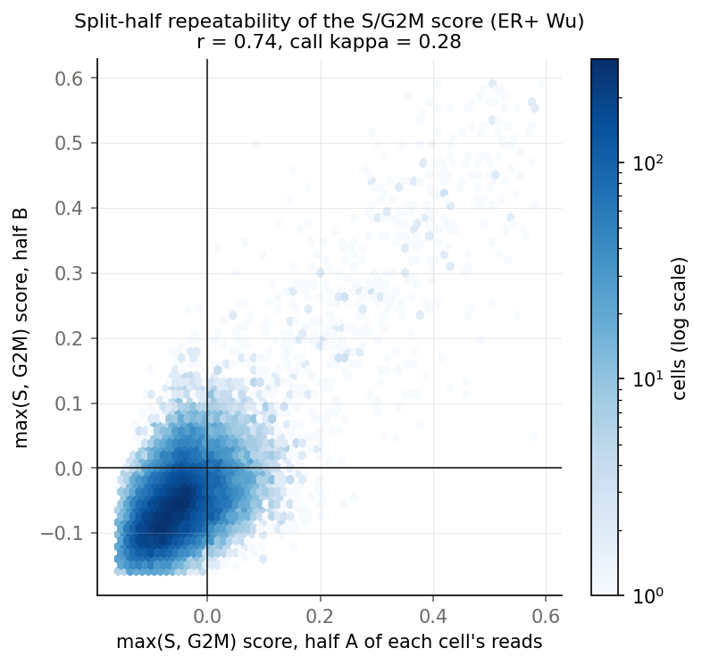
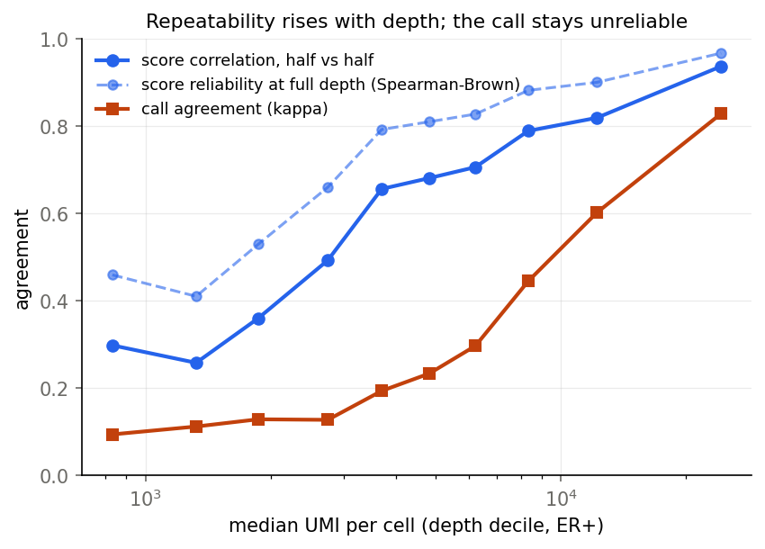
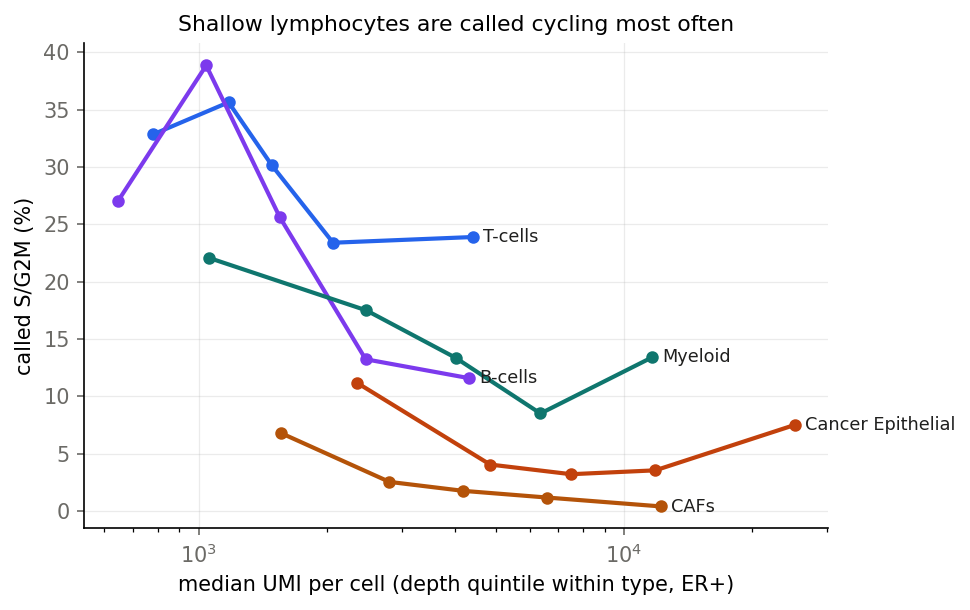
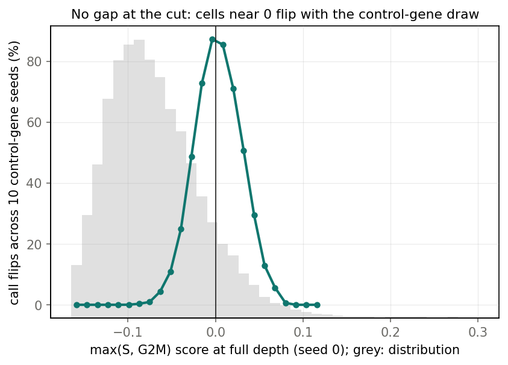

# Noise in Wu's whole-transcriptome S/G2M call (scanpy)

Generated by `run/division_wu_score_noise.py`.

```json
{
 "vs Wu's Seurat scores": {
  "r S": 0.9999999999999999,
  "r G2M": 0.9927008659018045,
  "r max": 0.99560738484043,
  "call kappa": 0.9078458974896869,
  "call rate scanpy / Seurat (ER+)": [
   0.11738709761774012,
   0.13192646635809732
  ]
 },
 "control-gene seeds": {
  "seeds": 10,
  "median per-cell SD of max score": 0.01726483989481815,
  "median |max score|": 0.07239103168317079,
  "cells whose call flips across seeds (ER+)": 0.16008995580659502,
  "of cells called at seed 0, share that flip (ER+)": 0.4517709957674315
 },
 "split half, ER+": {
  "cells": 38241,
  "median UMI": 4241.0,
  "split-half r": 0.736449280707611,
  "Spearman-Brown full-depth r": 0.8482243494120423,
  "split-half call kappa": 0.2762272664693176,
  "split-half call MCC": 0.2769085655875165,
  "half call vs full call MCC": 0.522807642214657,
  "call rate full": 0.11738709761774012,
  "call rate half": 0.17054993331764337
 },
 "split half, all patients": {
  "cells": 100064,
  "median UMI": 3573.0,
  "split-half r": 0.8579300175404868,
  "Spearman-Brown full-depth r": 0.9235331895613677,
  "split-half call kappa": 0.37446584645162573,
  "split-half call MCC": 0.37525361372435273,
  "half call vs full call MCC": 0.6021164712149354,
  "call rate full": 0.18195354972817396,
  "call rate half": 0.23188159577870163
 }
}
```

## Split-half repeatability by depth decile (ER+)

| depth decile | median UMI | split-half r | Spearman-Brown full-depth r | split-half call kappa | half call vs full call MCC | call rate full |
| --- | --- | --- | --- | --- | --- | --- |
| 1 | 833 | 0.299 | 0.46 | 0.0945 | 0.453 | 0.298 |
| 2 | 1.32e+03 | 0.258 | 0.411 | 0.112 | 0.421 | 0.285 |
| 3 | 1.87e+03 | 0.36 | 0.53 | 0.129 | 0.442 | 0.179 |
| 4 | 2.75e+03 | 0.493 | 0.661 | 0.128 | 0.381 | 0.101 |
| 5 | 3.7e+03 | 0.657 | 0.793 | 0.194 | 0.459 | 0.0806 |
| 6 | 4.82e+03 | 0.682 | 0.811 | 0.234 | 0.457 | 0.0638 |
| 7 | 6.22e+03 | 0.707 | 0.828 | 0.297 | 0.492 | 0.0419 |
| 8 | 8.34e+03 | 0.79 | 0.882 | 0.446 | 0.635 | 0.0345 |
| 9 | 1.22e+04 | 0.82 | 0.901 | 0.602 | 0.752 | 0.0332 |
| 10 | 2.43e+04 | 0.938 | 0.968 | 0.829 | 0.91 | 0.057 |

## By cell type (ER+)

| type | cells | median UMI | split-half r | Spearman-Brown full-depth r | split-half call kappa | half call vs full call MCC | call rate full |
| --- | --- | --- | --- | --- | --- | --- | --- |
| B-cells | 606 | 1.55e+03 | 0.218 | 0.358 | 0.138 | 0.385 | 0.233 |
| CAFs | 2573 | 4.19e+03 | 0.302 | 0.464 | 0.0869 | 0.281 | 0.0253 |
| Cancer Epithelial | 11878 | 7.51e+03 | 0.855 | 0.922 | 0.488 | 0.682 | 0.0588 |
| Endothelial | 5206 | 5.48e+03 | 0.394 | 0.565 | 0.123 | 0.361 | 0.033 |
| Myeloid | 1831 | 4.01e+03 | 0.763 | 0.866 | 0.275 | 0.558 | 0.15 |
| Normal Epithelial | 2430 | 6.96e+03 | 0.335 | 0.502 | 0.159 | 0.347 | 0.0391 |
| PVL | 3265 | 4.04e+03 | 0.397 | 0.568 | 0.108 | 0.296 | 0.0377 |
| Plasmablasts | 631 | 5.19e+03 | 0.332 | 0.498 | 0.124 | 0.524 | 0.0872 |
| T-cells | 9821 | 1.49e+03 | 0.622 | 0.767 | 0.125 | 0.444 | 0.292 |

## Call rate by depth quintile within type (ER+)

| type | quintile | median UMI | call rate | flip share |
| --- | --- | --- | --- | --- |
| Cancer Epithelial | 1 | 2.36e+03 | 0.112 | 0.14 |
| Cancer Epithelial | 2 | 4.84e+03 | 0.0404 | 0.048 |
| Cancer Epithelial | 3 | 7.51e+03 | 0.032 | 0.0194 |
| Cancer Epithelial | 4 | 1.18e+04 | 0.0354 | 0.0109 |
| Cancer Epithelial | 5 | 2.52e+04 | 0.0749 | 0.013 |
| T-cells | 1 | 782 | 0.328 | 0.429 |
| T-cells | 2 | 1.18e+03 | 0.356 | 0.444 |
| T-cells | 3 | 1.49e+03 | 0.301 | 0.443 |
| T-cells | 4 | 2.07e+03 | 0.234 | 0.396 |
| T-cells | 5 | 4.4e+03 | 0.239 | 0.322 |
| B-cells | 1 | 646 | 0.27 | 0.475 |
| B-cells | 2 | 1.04e+03 | 0.388 | 0.421 |
| B-cells | 3 | 1.55e+03 | 0.256 | 0.421 |
| B-cells | 4 | 2.47e+03 | 0.132 | 0.339 |
| B-cells | 5 | 4.33e+03 | 0.116 | 0.322 |
| Myeloid | 1 | 1.06e+03 | 0.221 | 0.302 |
| Myeloid | 2 | 2.48e+03 | 0.175 | 0.268 |
| Myeloid | 3 | 4.02e+03 | 0.134 | 0.174 |
| Myeloid | 4 | 6.36e+03 | 0.0849 | 0.115 |
| Myeloid | 5 | 1.16e+04 | 0.134 | 0.0464 |
| CAFs | 1 | 1.56e+03 | 0.068 | 0.181 |
| CAFs | 2 | 2.81e+03 | 0.0253 | 0.0992 |
| CAFs | 3 | 4.19e+03 | 0.0175 | 0.0583 |
| CAFs | 4 | 6.59e+03 | 0.0117 | 0.0117 |
| CAFs | 5 | 1.22e+04 | 0.00389 | 0.00389 |





