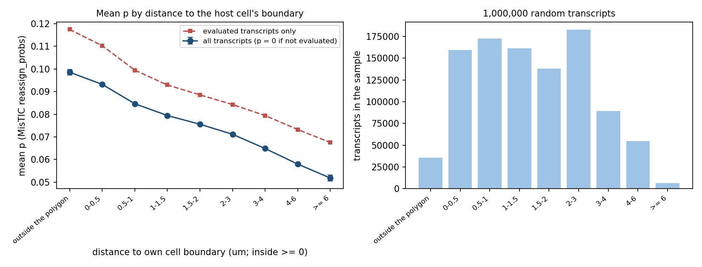
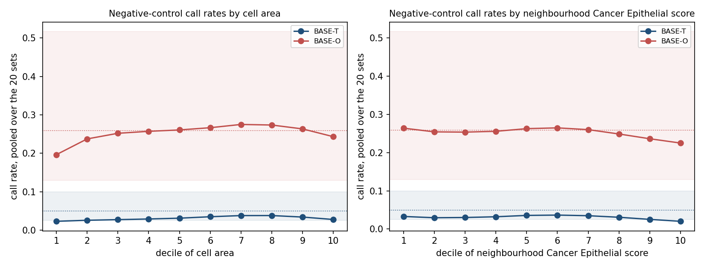
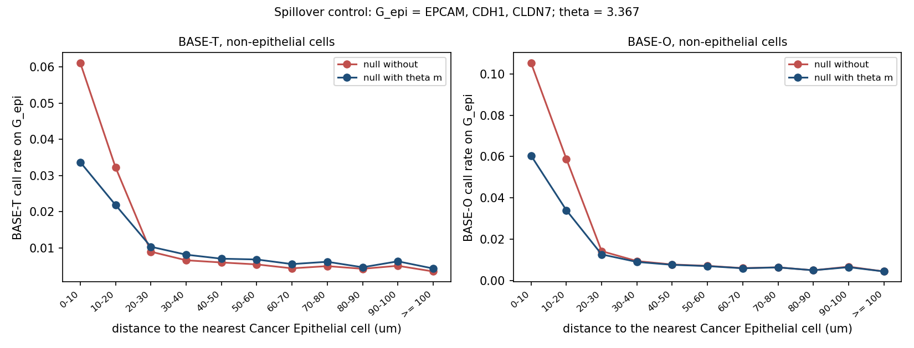

# MisTIC integration: test report

Spec: `instructions/mistic_implementation_spec.md`. Pipeline, inputs and the
probability column: `outputs/mistic/README.md`.

## Decisions taken in implementing the spec

| item | spec | adopted | why |
| --- | --- | --- | --- |
| MisTIC fit | one run | **36 spatial tiles**, 50 um halo, p kept for core cells (spec 1.4) | MisTIC's prior-expression table has a row per (cell, gene): 3.5 billion for the section. Equal-count tiles of ~19,000 core cells; cores partition the cells. |
| unevaluated transcripts | -- | **p = 0** | MisTIC only scores transcripts with a candidate cell of another type within 5 um; it has no evidence of misassignment for the rest. |
| cells left out of MisTIC's input | drop, log | 15,312 empty, 514 invalid polygons, 579 unlabelled; **their transcripts p = 0** | 304 analysis cells (0.05%) among them keep their raw library size and m = 0. |
| library size in the models | Nt over all transcripts (notation table) | **Nt_nonB**: sum of q over genes outside the blocklist | the spec rules out any use of cycle-gene p, which the all-gene Nt would put in the offset; the models' N already excludes the blocklist. `model.mistic_library_size` switches it. |
| N_i in m_i = f N s | raw total | raw total over all genes, as the spec | s's denominator is the same all-gene total |
| technical null | NB, mean Nt e^b0 + theta m | as the spec, keeping the existing **iterative trimming** (P(Y >= y) < 0.001) | the trimming is how BASE-T/BASE-O's null has always been estimated; only the mean function changed |
| LOG arms (division comparison) | general rule | area spline removed, log Nt for log N; **no m term** | their outcome is a label, not a raw count, so the additive rule does not apply |
| BASE-O-neg (a Stage 7 variant) | -- | **unchanged** | its floor is the negative-codeword rate per um^2 times area: decoding noise scales with area, it is not a segmentation covariate |
| area elsewhere | -- | kept as a **diagnostic axis** only (confound R^2, T3 deciles) | not a model term |
| old area fits | -- | `model.technical: area` reproduces them | needed for T6 |
| T5 | -- | **deferred** | PhiSpace is trained in R; the weighted matrix (`data/mistic/cell_feature_matrix_mistic.h5`) is ready for it |

Known limitation: MisTIC's own model sees cycle-gene transcripts when it
scores other genes; they are part of the expression profiles it compares. No
covariate the models read uses p of a cycle-gene transcript.

## Status

| test | status |
| --- | --- |
| T1. Likelihood recovery (blocking) | null: FAIL; mixture: FAIL |
| T2. MisTIC sanity (blocking) | PASS |
| T3. Null calibration negative control (blocking) | PASS |
| T4. Spillover control (report) | reported |
| T5. PhiSpace feature check (report) | deferred |
| T6. Old vs new comparison (report) | reported |

_Assembled 2026-10-12 23:27 at git 36c39a7._

## T1. Likelihood recovery, technical null — **FAIL**

200,000 analysis cells with their real Nt (Nt_nonB) and m (m_cyc); y ~ NB(Nt e^b0 + theta m, alpha) with the truth set to the null fitted to the real counts: b0 -4.9093, theta 2.7414, alpha 0.8540. Refitted by maximum likelihood (scipy L-BFGS-B, analytic gradients); standard errors from the observed information. Pass: every parameter of the primary draw within 2 SE.

| parameter | truth | estimate (primary) | SE | z | coverage of +/- 2 SE (50 draws) | mean z | sd z |
|---|---:|---:|---:|---:|---:|---:|---:|
| `b0` | -4.9093 | -4.9013 | 0.0058 | +1.39 | 96% | +0.31 | 0.82 |
| `eta` | 1.0085 | 0.9694 | 0.0180 | -2.17 | 96% | -0.20 | 0.89 |
| `log_alpha` | -0.1578 | -0.1669 | 0.0092 | -1.00 | 94% | -0.13 | 0.99 |

Coverage, mean z and sd z are over 50 further draws, reported rather than tested: about 95%, 0 and 1 if the estimator and its standard errors are right.

The primary draw puts `eta` outside 2 SE. Across the 50 further draws, coverage is 94-96%, |mean z| at most 0.31 and sd z 0.82-0.99: what an unbiased estimator with correct standard errors gives, so the miss is within chance (with three parameters about one draw in seven misses 2 SE somewhere). The spec's rule is applied as written.

T1's mixture half is Test 01 (spec 6.1) with the theta_m m term in every
component's mean, beside the same test as configured. Both are the latest runs
in `outputs/validation_report.md`. At full scale on 2026-10-12 (git b14ce20,
weight_ridge 300) the two failed identically, on a0 alone: the intercept of
the cycling probability, estimated -1.707 against -1.735 in both, because the
ridge on the weight slopes narrows the spread of the logit and the unpenalised
intercept moves to keep mean pi. The failure predates the MisTIC term. theta_m,
b0, theta, delta and B were all recovered.

_Test 01 with the theta_m m term:_

### Test 01 with theta_m m -- simulation recovery (MisTIC spec T1, mixture)

**FAIL**

| parameter | truth | mean estimate | MC SE | bias / SE |
|---|---:|---:|---:|---:|
| `b0` | -0.5500 | -0.5517 | 0.0018 | 0.94 |
| `theta` | 0.8500 | 0.8497 | 0.0007 | 0.37 |
| `delta` | 0.3266 | 0.3279 | 0.0011 | 1.17 |
| `a0` | -1.7346 | -1.7072 | 0.0053 | 5.14 |
| `eta_m` | 0.0000 | -0.0080 | 0.0072 | 1.11 |

- replicates: **20** at n = **100,000**; Stage B; theta free (V); state 6x8, rank 2; MisTIC theta_m m, no area
- `||B_hat - B||_F / ||B||_F`: mean **0.1277**, max 0.1992 (threshold 0.15 -> pass)

git: **b14ce20**
loglik: **-138374.965600**
||grad||inf: **1.95e-05**
iterations: **421**
converged: **True**
restart agreement: **80%**
wall time: **9.9s**
normalised entropy (spec 8.7): **0.5819**
rate ratio exp(e^delta): **3.971**
mean w: **0.1882**
degeneracy flags fired: **False**

_Test 01 as configured (the comparison):_

### Test 01 -- simulation recovery (spec 6.1)

**FAIL**

| parameter | truth | mean estimate | MC SE | bias / SE |
|---|---:|---:|---:|---:|
| `b0` | -0.5500 | -0.5527 | 0.0018 | 1.52 |
| `theta` | 0.8500 | 0.8505 | 0.0010 | 0.47 |
| `delta` | 0.3266 | 0.3292 | 0.0010 | 2.46 |
| `a0` | -1.7346 | -1.7073 | 0.0060 | 4.57 |

- replicates: **20** at n = **100,000**; Stage B; theta free (V); state 6x8, rank 2; area spline, df 3
- `||B_hat - B||_F / ||B||_F`: mean **0.1250**, max 0.2664 (threshold 0.15 -> pass)

git: **b14ce20**
loglik: **-132139.141505**
||grad||inf: **3.14e-05**
iterations: **833**
converged: **True**
restart agreement: **80%**
wall time: **11.7s**
normalised entropy (spec 8.7): **0.6149**
rate ratio exp(e^delta): **4.045**
mean w: **0.1824**
degeneracy flags fired: **False**

## T2. MisTIC sanity — **PASS**

- p in [0, 1] for every transcript: **pass**
- Nt <= N for every cell: **pass**
- Nt_nonB <= N_nonB for every cell: **pass**
- mean p at 0-0.5 um exceeds mean p at >= 4 um by > 3 SE: **pass**
- mean p falls with distance inside the cell (Spearman rho < -0.5): **pass**

Mean p at 0-0.5 um minus mean p at >= 4 um: **0.0359** (SE 0.0004); Spearman rho of mean p on bin distance, inside bins: **-1.00**.

| distance to own boundary (um) | transcripts | mean p | se | evaluated (p > 0) | mean p, evaluated only |
|---|---|---|---|---|---|
| outside the polygon | 35,509 | 0.0985 | 0.0006 | 0.8390 | 0.1174 |
| 0-0.5 | 159,599 | 0.0932 | 0.0003 | 0.8452 | 0.1102 |
| 0.5-1 | 172,606 | 0.0846 | 0.0002 | 0.8509 | 0.0995 |
| 1-1.5 | 161,607 | 0.0794 | 0.0002 | 0.8549 | 0.0929 |
| 1.5-2 | 137,852 | 0.0756 | 0.0002 | 0.8535 | 0.0885 |
| 2-3 | 182,672 | 0.0711 | 0.0002 | 0.8440 | 0.0843 |
| 3-4 | 89,128 | 0.0649 | 0.0002 | 0.8168 | 0.0794 |
| 4-6 | 54,591 | 0.0580 | 0.0003 | 0.7917 | 0.0732 |
| >= 6 | 6,436 | 0.0518 | 0.0007 | 0.7676 | 0.0675 |

## T3. Negative control: null calibration — **PASS**

20 sets of 53 genes outside the blocklist, matched gene by gene to the Tirosh genes (mean count 0.019 against 0.020; detection 0.017 against 0.017). Each set: the trimmed null mu = Nt e^b0 + theta m^G with its own m^G, BASE-T at alpha_B = 0.05, BASE-O at Td = 0.5 with per-type s+.

- BASE-T: overall rate 0.0309 within [0.0250, 0.1000]: **pass**
- BASE-T: max/min decile rate by cell area = 1.65 < 2: **pass**
- BASE-T: max/min decile rate by neighbourhood Cancer Epithelial score = 1.80 < 2: **pass**
- BASE-O: overall rate 0.2526 within [0.1293, 0.5172]: **pass**
- BASE-O: max/min decile rate by cell area = 1.40 < 2: **pass**
- BASE-O: max/min decile rate by neighbourhood Cancer Epithelial score = 1.18 < 2: **pass**

BASE-T's attainable level, the mean realised alpha_i, is 0.0254 (pooled); BASE-O's null rate is 0.2586. Fitted theta_m across sets: 0.921 to 2.930 (median 1.675).

Per set:

| set | mean count | mean m | theta_m | alpha0 | BASE-T rate | BASE-T attainable level (mean alpha_i) | BASE-O rate | BASE-O null rate |
|---|---|---|---|---|---|---|---|---|
| 0.0000 | 1.0371 | 0.0824 | 1.6173 | 0.1299 | 0.0300 | 0.0254 | 0.2548 | 0.2601 |
| 1.0000 | 1.0392 | 0.0818 | 1.4000 | 0.1238 | 0.0293 | 0.0252 | 0.2461 | 0.2585 |
| 2.0000 | 1.0374 | 0.0830 | 2.9302 | 0.2219 | 0.0339 | 0.0266 | 0.2480 | 0.2516 |
| 3.0000 | 1.0247 | 0.0808 | 1.1876 | 0.1017 | 0.0301 | 0.0249 | 0.2582 | 0.2612 |
| 4.0000 | 1.0355 | 0.0821 | 2.0176 | 0.1717 | 0.0325 | 0.0259 | 0.2532 | 0.2559 |
| 5.0000 | 1.0196 | 0.0806 | 1.7326 | 0.1398 | 0.0306 | 0.0254 | 0.2516 | 0.2576 |
| 6.0000 | 1.0421 | 0.0833 | 2.3987 | 0.1837 | 0.0337 | 0.0262 | 0.2518 | 0.2559 |
| 7.0000 | 1.0276 | 0.0806 | 1.2294 | 0.1060 | 0.0297 | 0.0249 | 0.2518 | 0.2616 |
| 8.0000 | 1.0276 | 0.0819 | 1.9447 | 0.1635 | 0.0312 | 0.0259 | 0.2619 | 0.2579 |
| 9.0000 | 1.0275 | 0.0811 | 1.2062 | 0.0955 | 0.0312 | 0.0248 | 0.2562 | 0.2622 |
| 10.0000 | 1.0387 | 0.0824 | 1.7698 | 0.1232 | 0.0295 | 0.0251 | 0.2417 | 0.2593 |
| 11.0000 | 1.0383 | 0.0830 | 1.6010 | 0.1344 | 0.0318 | 0.0255 | 0.2555 | 0.2591 |
| 12.0000 | 1.0356 | 0.0816 | 1.2469 | 0.0949 | 0.0294 | 0.0248 | 0.2527 | 0.2619 |
| 13.0000 | 1.0171 | 0.0801 | 1.8185 | 0.1812 | 0.0328 | 0.0261 | 0.2564 | 0.2551 |
| 14.0000 | 1.0433 | 0.0837 | 2.4506 | 0.1718 | 0.0327 | 0.0260 | 0.2498 | 0.2563 |
| 15.0000 | 1.0425 | 0.0830 | 1.8354 | 0.1313 | 0.0292 | 0.0252 | 0.2426 | 0.2571 |
| 16.0000 | 1.0433 | 0.0844 | 2.5992 | 0.1693 | 0.0330 | 0.0260 | 0.2514 | 0.2567 |
| 17.0000 | 1.0232 | 0.0802 | 0.9210 | 0.0829 | 0.0281 | 0.0246 | 0.2524 | 0.2616 |
| 18.0000 | 1.0178 | 0.0802 | 1.2044 | 0.0993 | 0.0295 | 0.0248 | 0.2557 | 0.2612 |
| 19.0000 | 1.0146 | 0.0801 | 1.2584 | 0.0945 | 0.0300 | 0.0248 | 0.2602 | 0.2619 |

By decile (pooled over the sets):

| decile | BASE-T rate, cell area | BASE-T rate, neighbourhood Cancer Epithelial score | BASE-O rate, cell area | BASE-O rate, neighbourhood Cancer Epithelial score |
|---|---|---|---|---|
| 1.0000 | 0.0230 | 0.0330 | 0.1965 | 0.2641 |
| 2.0000 | 0.0257 | 0.0297 | 0.2374 | 0.2544 |
| 3.0000 | 0.0274 | 0.0303 | 0.2521 | 0.2537 |
| 4.0000 | 0.0291 | 0.0322 | 0.2572 | 0.2558 |
| 5.0000 | 0.0312 | 0.0357 | 0.2608 | 0.2628 |
| 6.0000 | 0.0349 | 0.0366 | 0.2666 | 0.2648 |
| 7.0000 | 0.0379 | 0.0350 | 0.2751 | 0.2602 |
| 8.0000 | 0.0380 | 0.0309 | 0.2736 | 0.2488 |
| 9.0000 | 0.0341 | 0.0254 | 0.2635 | 0.2363 |
| 10.0000 | 0.0278 | 0.0203 | 0.2433 | 0.2251 |

## T4. Spillover control (report)

G_epi = **EPCAM, CDH1, CLDN7**, in 401,957 non-epithelial analysis cells. Fitted theta = **3.3668** (SE of eta 0.0138); alpha0 1.2142 with the term, 3.6058 without.

Call rate at 0-10 um over the rate at 90-100 um:

- BASE-T, without: **12.04**
- BASE-T, with theta m: **5.34**
- BASE-O, without: **15.76**
- BASE-O, with theta m: **9.40**

| distance to nearest Cancer Epithelial (um) | cells | mean G_epi count | mean m | BASE-T, with theta m | BASE-O, with theta m | BASE-T, without | BASE-O, without |
|---|---|---|---|---|---|---|---|
| 0-10 | 41231 | 0.1445 | 0.0267 | 0.0337 | 0.0605 | 0.0611 | 0.1053 |
| 10-20 | 79340 | 0.0904 | 0.0169 | 0.0219 | 0.0340 | 0.0323 | 0.0589 |
| 20-30 | 63734 | 0.0170 | 0.0026 | 0.0103 | 0.0126 | 0.0090 | 0.0142 |
| 30-40 | 52389 | 0.0104 | 0.0012 | 0.0082 | 0.0090 | 0.0066 | 0.0094 |
| 40-50 | 41188 | 0.0084 | 0.0008 | 0.0070 | 0.0076 | 0.0060 | 0.0077 |
| 50-60 | 31509 | 0.0077 | 0.0007 | 0.0068 | 0.0070 | 0.0055 | 0.0071 |
| 60-70 | 23073 | 0.0063 | 0.0006 | 0.0055 | 0.0059 | 0.0044 | 0.0060 |
| 70-80 | 16646 | 0.0067 | 0.0006 | 0.0062 | 0.0063 | 0.0050 | 0.0064 |
| 80-90 | 11771 | 0.0056 | 0.0006 | 0.0047 | 0.0049 | 0.0042 | 0.0049 |
| 90-100 | 8080 | 0.0073 | 0.0005 | 0.0063 | 0.0064 | 0.0051 | 0.0067 |
| >= 100 | 32996 | 0.0045 | 0.0003 | 0.0043 | 0.0044 | 0.0035 | 0.0044 |

Gene choice:

| gene | on panel | in B | epithelial / other mean count | used |
|---|---|---|---|---|
| EPCAM | True | False | 20.5143 | True |
| KRT8 | False | None | nan | False |
| KRT18 | False | None | nan | False |
| KRT19 | False | None | nan | False |
| CDH1 | True | False | 15.1980 | True |
| CLDN7 | True | False | 16.6148 | True |

## T5. PhiSpace feature check (report)

Deferred: PhiSpace is trained in R. Its MisTIC input, X~ = sum of q per cell and gene, is `data/mistic/cell_feature_matrix_mistic.h5`.

## T6. Old (area) against new (MisTIC) fits (report)

Mixture point estimates from `outputs/hpc` (area) and `outputs/hpc_mistic_pending` (MisTIC); bracketed: 95% spatial block bootstrap intervals (300 and 0 replicates).

| quantity | area | MisTIC |
|---|---|---|
| e^delta | 1.7231 (1.7066, 1.7412) | pending |
| theta_m | -- | pending |
| cycling fraction, mean prior pi | 0.1259 | pending |
| cycling fraction, mean posterior w | 0.1260 (0.1208, 0.1320) | pending |

Odds ratio of cycling per IQR of each neighbourhood component, priority pairs both ways round (own archetype; contact = 0-15 um, regional = 15-80 um):

| own archetype | neighbour component | area | MisTIC |
|---|---|---|---|
| CAFs | contact: Myeloid | 0.9326 (0.8870, 0.9705) | pending |
| CAFs | regional: Myeloid | 1.1299 (1.0299, 1.2278) | pending |
| Cancer Epithelial | contact: CAFs | 0.9343 (0.9023, 0.9627) | pending |
| Cancer Epithelial | regional: CAFs | 1.0039 (0.9236, 1.0784) | pending |
| Cancer Epithelial | contact: Myeloid | 0.9302 (0.8982, 0.9646) | pending |
| Cancer Epithelial | regional: Myeloid | 1.0881 (1.0029, 1.1748) | pending |
| Cancer Epithelial | contact: T-cells | 1.3700 (1.2901, 1.4463) | pending |
| Cancer Epithelial | regional: T-cells | 1.0273 (0.9272, 1.1440) | pending |
| Myeloid | contact: CAFs | 0.9326 (0.8919, 0.9656) | pending |
| Myeloid | regional: CAFs | 1.0059 (0.9406, 1.0882) | pending |
| CAFs | contact: Cancer Epithelial | 1.8723 (1.7349, 2.0454) | pending |
| CAFs | regional: Cancer Epithelial | 1.4619 (1.2209, 1.7684) | pending |
| Myeloid | contact: Cancer Epithelial | 2.0259 (1.8745, 2.2045) | pending |
| Myeloid | regional: Cancer Epithelial | 1.0347 (0.8645, 1.2877) | pending |
| T-cells | contact: Cancer Epithelial | 2.2714 (2.0855, 2.4947) | pending |
| T-cells | regional: Cancer Epithelial | 1.2729 (1.0340, 1.5268) | pending |

Division labels, call rate per archetype (area null: log N offset + area spline; MisTIC null: weighted N offset + theta m, theta = 2.8185):

| archetype | cells | BASE-T, area | BASE-T, MisTIC | BASE-O, area | BASE-O, MisTIC |
|---|---|---|---|---|---|
| all | 561897 | 0.0344 | 0.0329 | 0.1828 | 0.1818 |
| Endothelial | 48729 | 0.0116 | 0.0107 | 0.1215 | 0.1242 |
| CAFs | 52079 | 0.0097 | 0.0087 | 0.1288 | 0.1318 |
| PVL | 42834 | 0.0187 | 0.0146 | 0.1476 | 0.1462 |
| B-cells | 59119 | 0.0243 | 0.0198 | 0.2112 | 0.2018 |
| T-cells | 87004 | 0.0320 | 0.0273 | 0.2384 | 0.2286 |
| Myeloid | 69669 | 0.0146 | 0.0129 | 0.1372 | 0.1367 |
| Normal Epithelial | 54508 | 0.0337 | 0.0264 | 0.1670 | 0.1632 |
| Plasmablasts | 42523 | 0.0427 | 0.0329 | 0.2007 | 0.1906 |
| Cancer Epithelial | 105432 | 0.0812 | 0.0912 | 0.2215 | 0.2338 |
