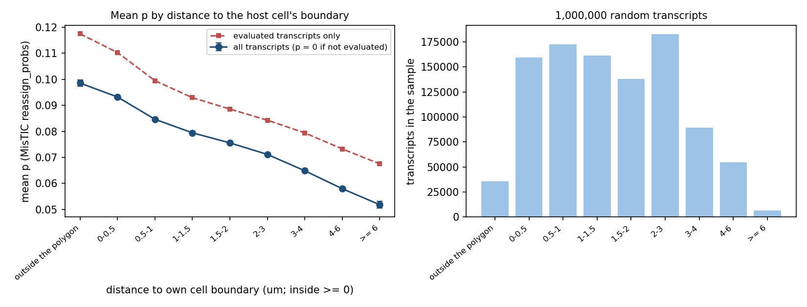

## T2. MisTIC sanity — **PASS**

- p in [0, 1] for every transcript: **pass**
- Nt <= N for every cell: **pass**
- Nt_nonB <= N_nonB for every cell: **pass**
- mean p at 0-0.5 um exceeds mean p at >= 4 um by > 3 SE: **pass**
- mean p falls with distance inside the cell (Spearman rho < -0.5): **pass**

Mean p at 0-0.5 um minus mean p at >= 4 um: **0.0359** (SE 0.0004); Spearman rho of mean p on bin distance, inside bins: **-1.00**.

| distance to own boundary (um) | transcripts | mean p | se | evaluated (p > 0) | mean p, evaluated only |
|---|---|---|---|---|---|
| outside the polygon | 35,509 | 0.0985 | 0.0006 | 0.8390 | 0.1174 |
| 0-0.5 | 159,599 | 0.0932 | 0.0003 | 0.8452 | 0.1102 |
| 0.5-1 | 172,606 | 0.0846 | 0.0002 | 0.8509 | 0.0995 |
| 1-1.5 | 161,607 | 0.0794 | 0.0002 | 0.8549 | 0.0929 |
| 1.5-2 | 137,852 | 0.0756 | 0.0002 | 0.8535 | 0.0885 |
| 2-3 | 182,672 | 0.0711 | 0.0002 | 0.8440 | 0.0843 |
| 3-4 | 89,128 | 0.0649 | 0.0002 | 0.8168 | 0.0794 |
| 4-6 | 54,591 | 0.0580 | 0.0003 | 0.7917 | 0.0732 |
| >= 6 | 6,436 | 0.0518 | 0.0007 | 0.7676 | 0.0675 |

