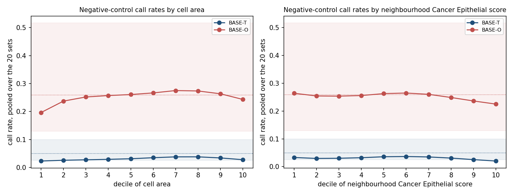

## T3. Negative control: null calibration — **PASS**

20 sets of 53 genes outside the blocklist, matched gene by gene to the Tirosh genes (mean count 0.019 against 0.020; detection 0.017 against 0.017). Each set: the trimmed null mu = Nt e^b0 + theta m^G with its own m^G, BASE-T at alpha_B = 0.05, BASE-O at Td = 0.5 with per-type s+.

- BASE-T: overall rate 0.0309 within [0.0250, 0.1000]: **pass**
- BASE-T: max/min decile rate by cell area = 1.65 < 2: **pass**
- BASE-T: max/min decile rate by neighbourhood Cancer Epithelial score = 1.80 < 2: **pass**
- BASE-O: overall rate 0.2526 within [0.1293, 0.5172]: **pass**
- BASE-O: max/min decile rate by cell area = 1.40 < 2: **pass**
- BASE-O: max/min decile rate by neighbourhood Cancer Epithelial score = 1.18 < 2: **pass**

BASE-T's attainable level, the mean realised alpha_i, is 0.0254 (pooled); BASE-O's null rate is 0.2586. Fitted theta_m across sets: 0.921 to 2.930 (median 1.675).

Per set:

| set | mean count | mean m | theta_m | alpha0 | BASE-T rate | BASE-T attainable level (mean alpha_i) | BASE-O rate | BASE-O null rate |
|---|---|---|---|---|---|---|---|---|
| 0.0000 | 1.0371 | 0.0824 | 1.6173 | 0.1299 | 0.0300 | 0.0254 | 0.2548 | 0.2601 |
| 1.0000 | 1.0392 | 0.0818 | 1.4000 | 0.1238 | 0.0293 | 0.0252 | 0.2461 | 0.2585 |
| 2.0000 | 1.0374 | 0.0830 | 2.9302 | 0.2219 | 0.0339 | 0.0266 | 0.2480 | 0.2516 |
| 3.0000 | 1.0247 | 0.0808 | 1.1876 | 0.1017 | 0.0301 | 0.0249 | 0.2582 | 0.2612 |
| 4.0000 | 1.0355 | 0.0821 | 2.0176 | 0.1717 | 0.0325 | 0.0259 | 0.2532 | 0.2559 |
| 5.0000 | 1.0196 | 0.0806 | 1.7326 | 0.1398 | 0.0306 | 0.0254 | 0.2516 | 0.2576 |
| 6.0000 | 1.0421 | 0.0833 | 2.3987 | 0.1837 | 0.0337 | 0.0262 | 0.2518 | 0.2559 |
| 7.0000 | 1.0276 | 0.0806 | 1.2294 | 0.1060 | 0.0297 | 0.0249 | 0.2518 | 0.2616 |
| 8.0000 | 1.0276 | 0.0819 | 1.9447 | 0.1635 | 0.0312 | 0.0259 | 0.2619 | 0.2579 |
| 9.0000 | 1.0275 | 0.0811 | 1.2062 | 0.0955 | 0.0312 | 0.0248 | 0.2562 | 0.2622 |
| 10.0000 | 1.0387 | 0.0824 | 1.7698 | 0.1232 | 0.0295 | 0.0251 | 0.2417 | 0.2593 |
| 11.0000 | 1.0383 | 0.0830 | 1.6010 | 0.1344 | 0.0318 | 0.0255 | 0.2555 | 0.2591 |
| 12.0000 | 1.0356 | 0.0816 | 1.2469 | 0.0949 | 0.0294 | 0.0248 | 0.2527 | 0.2619 |
| 13.0000 | 1.0171 | 0.0801 | 1.8185 | 0.1812 | 0.0328 | 0.0261 | 0.2564 | 0.2551 |
| 14.0000 | 1.0433 | 0.0837 | 2.4506 | 0.1718 | 0.0327 | 0.0260 | 0.2498 | 0.2563 |
| 15.0000 | 1.0425 | 0.0830 | 1.8354 | 0.1313 | 0.0292 | 0.0252 | 0.2426 | 0.2571 |
| 16.0000 | 1.0433 | 0.0844 | 2.5992 | 0.1693 | 0.0330 | 0.0260 | 0.2514 | 0.2567 |
| 17.0000 | 1.0232 | 0.0802 | 0.9210 | 0.0829 | 0.0281 | 0.0246 | 0.2524 | 0.2616 |
| 18.0000 | 1.0178 | 0.0802 | 1.2044 | 0.0993 | 0.0295 | 0.0248 | 0.2557 | 0.2612 |
| 19.0000 | 1.0146 | 0.0801 | 1.2584 | 0.0945 | 0.0300 | 0.0248 | 0.2602 | 0.2619 |

By decile (pooled over the sets):

| decile | BASE-T rate, cell area | BASE-T rate, neighbourhood Cancer Epithelial score | BASE-O rate, cell area | BASE-O rate, neighbourhood Cancer Epithelial score |
|---|---|---|---|---|
| 1.0000 | 0.0230 | 0.0330 | 0.1965 | 0.2641 |
| 2.0000 | 0.0257 | 0.0297 | 0.2374 | 0.2544 |
| 3.0000 | 0.0274 | 0.0303 | 0.2521 | 0.2537 |
| 4.0000 | 0.0291 | 0.0322 | 0.2572 | 0.2558 |
| 5.0000 | 0.0312 | 0.0357 | 0.2608 | 0.2628 |
| 6.0000 | 0.0349 | 0.0366 | 0.2666 | 0.2648 |
| 7.0000 | 0.0379 | 0.0350 | 0.2751 | 0.2602 |
| 8.0000 | 0.0380 | 0.0309 | 0.2736 | 0.2488 |
| 9.0000 | 0.0341 | 0.0254 | 0.2635 | 0.2363 |
| 10.0000 | 0.0278 | 0.0203 | 0.2433 | 0.2251 |

