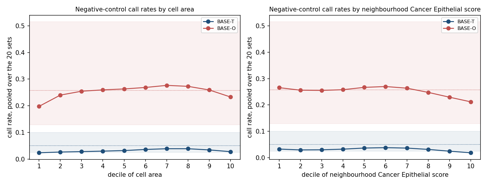

## T3 on the plain baseline's null (raw N offset; no area, no MisTIC) — **FAIL**

20 sets of 53 genes outside the blocklist, matched gene by gene to the Tirosh genes (mean count 0.019 against 0.020; detection 0.017 against 0.017). Each set: the trimmed null mu = N e^b0 (raw N offset, no MisTIC term), BASE-T at alpha_B = 0.05, BASE-O at Td = 0.5 with per-type s+.

- BASE-T: overall rate 0.0313 within [0.0250, 0.1000]: **pass**
- BASE-T: max/min decile rate by cell area = 1.65 < 2: **pass**
- BASE-T: max/min decile rate by neighbourhood Cancer Epithelial score = 2.02 < 2: **FAIL**
- BASE-O: overall rate 0.2524 within [0.1289, 0.5155]: **pass**
- BASE-O: max/min decile rate by cell area = 1.40 < 2: **pass**
- BASE-O: max/min decile rate by neighbourhood Cancer Epithelial score = 1.27 < 2: **pass**

BASE-T's attainable level, the mean realised alpha_i, is 0.0256 (pooled); BASE-O's null rate is 0.2578.

Per set:

| set | mean count | mean m | theta_m | alpha0 | BASE-T rate | BASE-T attainable level (mean alpha_i) | BASE-O rate | BASE-O null rate |
|---|---|---|---|---|---|---|---|---|
| 0.0000 | 1.0371 | nan | nan | 0.1407 | 0.0302 | 0.0255 | 0.2549 | 0.2600 |
| 1.0000 | 1.0392 | nan | nan | 0.1288 | 0.0297 | 0.0252 | 0.2453 | 0.2596 |
| 2.0000 | 1.0374 | nan | nan | 0.2776 | 0.0351 | 0.0273 | 0.2462 | 0.2483 |
| 3.0000 | 1.0247 | nan | nan | 0.1050 | 0.0301 | 0.0248 | 0.2583 | 0.2613 |
| 4.0000 | 1.0355 | nan | nan | 0.1943 | 0.0329 | 0.0259 | 0.2543 | 0.2542 |
| 5.0000 | 1.0196 | nan | nan | 0.1557 | 0.0311 | 0.0257 | 0.2523 | 0.2561 |
| 6.0000 | 1.0421 | nan | nan | 0.2160 | 0.0350 | 0.0267 | 0.2501 | 0.2533 |
| 7.0000 | 1.0276 | nan | nan | 0.1106 | 0.0298 | 0.0250 | 0.2522 | 0.2607 |
| 8.0000 | 1.0276 | nan | nan | 0.1862 | 0.0311 | 0.0260 | 0.2636 | 0.2554 |
| 9.0000 | 1.0275 | nan | nan | 0.0987 | 0.0314 | 0.0249 | 0.2562 | 0.2613 |
| 10.0000 | 1.0387 | nan | nan | 0.1331 | 0.0298 | 0.0253 | 0.2409 | 0.2579 |
| 11.0000 | 1.0383 | nan | nan | 0.1437 | 0.0323 | 0.0256 | 0.2556 | 0.2591 |
| 12.0000 | 1.0356 | nan | nan | 0.0976 | 0.0295 | 0.0249 | 0.2535 | 0.2621 |
| 13.0000 | 1.0171 | nan | nan | 0.2032 | 0.0327 | 0.0260 | 0.2571 | 0.2536 |
| 14.0000 | 1.0433 | nan | nan | 0.1986 | 0.0339 | 0.0262 | 0.2472 | 0.2539 |
| 15.0000 | 1.0425 | nan | nan | 0.1448 | 0.0298 | 0.0257 | 0.2416 | 0.2585 |
| 16.0000 | 1.0433 | nan | nan | 0.2036 | 0.0345 | 0.0264 | 0.2495 | 0.2553 |
| 17.0000 | 1.0232 | nan | nan | 0.0838 | 0.0282 | 0.0247 | 0.2524 | 0.2624 |
| 18.0000 | 1.0178 | nan | nan | 0.1036 | 0.0293 | 0.0247 | 0.2558 | 0.2611 |
| 19.0000 | 1.0146 | nan | nan | 0.0995 | 0.0301 | 0.0246 | 0.2609 | 0.2611 |

By decile (pooled over the sets):

| decile | BASE-T rate, cell area | BASE-T rate, neighbourhood Cancer Epithelial score | BASE-O rate, cell area | BASE-O rate, neighbourhood Cancer Epithelial score |
|---|---|---|---|---|
| 1.0000 | 0.0234 | 0.0330 | 0.1975 | 0.2657 |
| 2.0000 | 0.0261 | 0.0298 | 0.2399 | 0.2560 |
| 3.0000 | 0.0277 | 0.0303 | 0.2545 | 0.2551 |
| 4.0000 | 0.0296 | 0.0327 | 0.2595 | 0.2579 |
| 5.0000 | 0.0317 | 0.0369 | 0.2630 | 0.2667 |
| 6.0000 | 0.0358 | 0.0383 | 0.2686 | 0.2699 |
| 7.0000 | 0.0386 | 0.0367 | 0.2765 | 0.2636 |
| 8.0000 | 0.0386 | 0.0318 | 0.2728 | 0.2477 |
| 9.0000 | 0.0341 | 0.0249 | 0.2591 | 0.2295 |
| 10.0000 | 0.0275 | 0.0190 | 0.2327 | 0.2119 |

