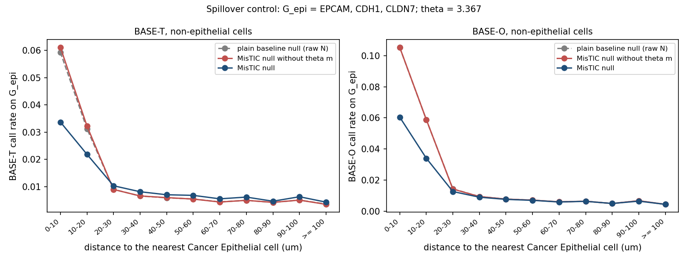

## T4. Spillover control (report)

G_epi = **EPCAM, CDH1, CLDN7**, in 401,957 non-epithelial analysis cells. Fitted theta = **3.3668** (SE of eta 0.0138); alpha0 1.2142 with the term, 3.6058 without.

Call rate at 0-10 um over the rate at 90-100 um:

- BASE-T, plain baseline: **11.69**
- BASE-T, without: **12.04**
- BASE-T, with theta m: **5.34**
- BASE-O, plain baseline: **15.75**
- BASE-O, without: **15.76**
- BASE-O, with theta m: **9.40**

(plain baseline: raw N offset, no MisTIC term; without: MisTIC-weighted N offset, no theta m; with theta m: the MisTIC null.)

| distance to nearest Cancer Epithelial (um) | cells | mean G_epi count | mean m | BASE-T, with theta m | BASE-O, with theta m | BASE-T, without | BASE-O, without | BASE-T, plain baseline | BASE-O, plain baseline |
|---|---|---|---|---|---|---|---|---|---|
| 0-10 | 41231 | 0.1445 | 0.0267 | 0.0337 | 0.0605 | 0.0611 | 0.1053 | 0.0593 | 0.1052 |
| 10-20 | 79340 | 0.0904 | 0.0169 | 0.0219 | 0.0340 | 0.0323 | 0.0589 | 0.0312 | 0.0588 |
| 20-30 | 63734 | 0.0170 | 0.0026 | 0.0103 | 0.0126 | 0.0090 | 0.0142 | 0.0090 | 0.0143 |
| 30-40 | 52389 | 0.0104 | 0.0012 | 0.0082 | 0.0090 | 0.0066 | 0.0094 | 0.0066 | 0.0094 |
| 40-50 | 41188 | 0.0084 | 0.0008 | 0.0070 | 0.0076 | 0.0060 | 0.0077 | 0.0059 | 0.0077 |
| 50-60 | 31509 | 0.0077 | 0.0007 | 0.0068 | 0.0070 | 0.0055 | 0.0071 | 0.0055 | 0.0071 |
| 60-70 | 23073 | 0.0063 | 0.0006 | 0.0055 | 0.0059 | 0.0044 | 0.0060 | 0.0044 | 0.0060 |
| 70-80 | 16646 | 0.0067 | 0.0006 | 0.0062 | 0.0063 | 0.0050 | 0.0064 | 0.0050 | 0.0064 |
| 80-90 | 11771 | 0.0056 | 0.0006 | 0.0047 | 0.0049 | 0.0042 | 0.0049 | 0.0042 | 0.0049 |
| 90-100 | 8080 | 0.0073 | 0.0005 | 0.0063 | 0.0064 | 0.0051 | 0.0067 | 0.0051 | 0.0067 |
| >= 100 | 32996 | 0.0045 | 0.0003 | 0.0043 | 0.0044 | 0.0035 | 0.0044 | 0.0036 | 0.0044 |

Gene choice:

| gene | on panel | in B | epithelial / other mean count | used |
|---|---|---|---|---|
| EPCAM | True | False | 20.5143 | True |
| KRT8 | False | None | nan | False |
| KRT18 | False | None | nan | False |
| KRT19 | False | None | nan | False |
| CDH1 | True | False | 15.1980 | True |
| CLDN7 | True | False | 16.6148 | True |

